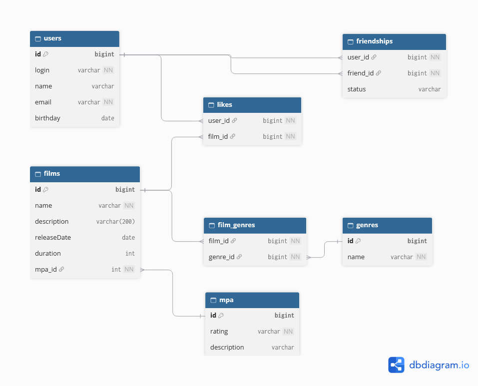

# База данных

## Схема

## Таблицы:
- users - пользователи
- friendships - дружба между пользователями
- genres - жанры
- mpa - рейтинг MPA фильмов
- films - фильмы
- likes - лайки фильмов
- film_genres - жанры фильмов

## Примеры запросов

### TOP-10 популярных фильмов

SELECT f.*, m."rating" AS mpa_rating
FROM "films" AS f
LEFT JOIN "mpa" AS m ON f."mpa_id" = m."id"
LEFT JOIN "likes" AS l ON f."id" = l."film_id"
GROUP BY f."id", m."rating"
ORDER BY COUNT(l."user_id") DESC
LIMIT 10;

### Список всех друзей пользователя

SELECT u.*
FROM "users" AS u
JOIN "friendships" AS f ON u."id" = f."friend_id"
WHERE f."user_id" = ?; -- id пользователя

